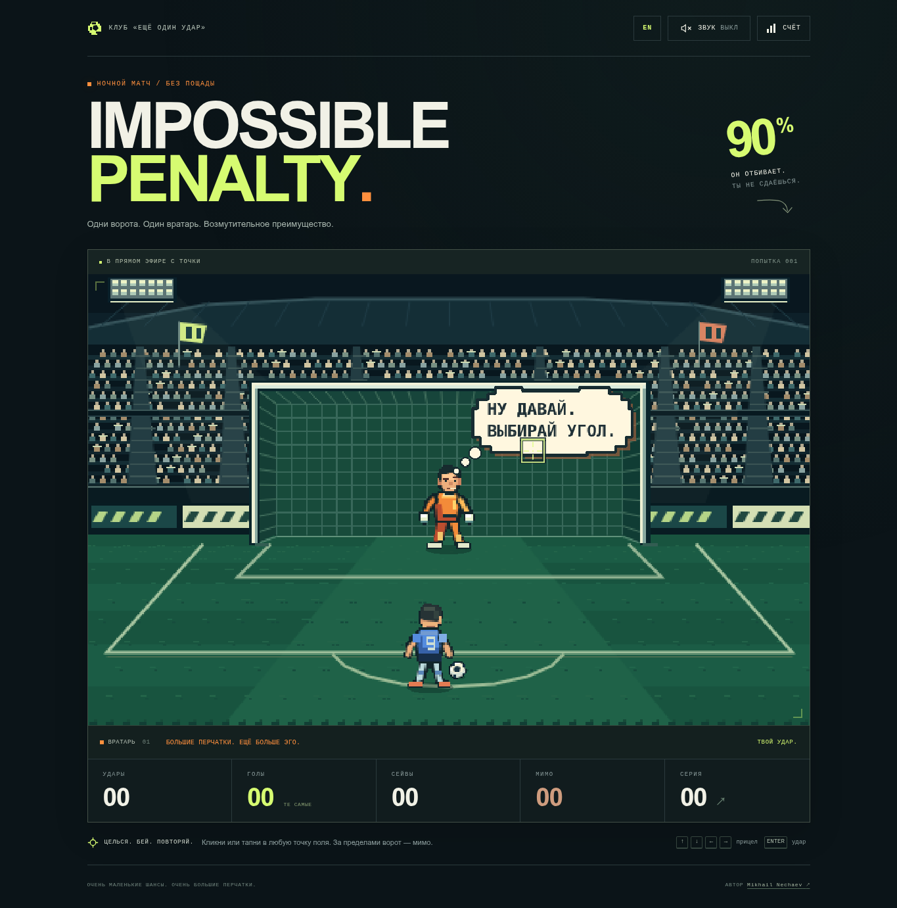

# IMPOSSIBLE PENALTY



**Один мяч. Один вратарь. Очень маленький шанс на славу.**

Законченная браузерная футбольная аркада в оригинальном пиксельном стиле: ночной стадион, оранжевый вратарь с большим самомнением и пенальти, после которого хочется попробовать ещё раз.

Наведите прицел на поле и нажмите. Футболист разбежится, ударит, а вратарь почти наверняка совершит очередной невозможный сейв. Цельтесь в створ: удар за пределы рамки станет промахом. Иногда удача будет на вашей стороне, а иногда матч прервёт выбежавший на поле болельщик.

[Исходный код на GitHub](https://github.com/m1ssha/impossible-penalty) · [Лицензия MIT](LICENSE)

## Что есть в игре

- Свободный выбор точки удара на всём поле мышью, касанием или клавиатурой. Можно пробить выше или мимо ворот; оранжевый прицел предупреждает о промахе.
- Разбег, удар, полёт мяча с перспективой, прыжки вратаря, отскоки и реакция сетки.
- При ударе в створ три характера сейва: **Predictor — 50%**, **Flash — 25%**, **Showoff — 15%**. **Lucky Shot — 10%**: гол.
- Независимая случайность для каждого удара в створ. Десятый удар не обязан быть голом; возможны любые серии. Выбранная точка вне створа всегда даёт промах.
- Вратарь помнит шесть последних направлений в створ, угадывает ваши привычки и комментирует происходящее. Эта память меняет поведение и реплики, сохраняя базовую вероятность гола.
- Редкие реакции: зевок, аплодисменты, газета, сигарета с пиксельным дымом и сейв одной рукой.
- В 18% сейвов вратарь во время прыжка плавно становится гигантом, затем возвращается к обычному размеру.
- В 28% уже выбранных голевых эпизодов на поле выбегает болельщик в ярком шарфе, бьёт вместо игрока и гарантированно забивает. Общая вероятность гола при ударе в створ остаётся 10%.
- Счётчики ударов, голов, сейвов, промахов, текущей и рекордной серии, процент реализации. Гол и промах обрывают текущую серию сейвов.
- Сохранение статистики и настроек в браузере, подтверждаемый сброс результатов.
- Оригинальные синтезированные звуки удара, сейва, гола и фон стадиона.
- Адаптивный интерфейс, управление с клавиатуры и режим уменьшения анимаций.

Интерфейс и реплики в игре на английском языке, документация — на русском. Аккаунт, серверная часть и внешние сервисы для игры не нужны.

## Быстрый запуск

Нужны **Node.js 22.12.0 или новее** и npm, который устанавливается вместе с Node.js. Подойдёт актуальная LTS-версия Node.js. Установите её с [официального сайта Node.js](https://nodejs.org/).

Откройте терминал: PowerShell в Windows, Terminal в macOS или терминал вашего Linux. Проверить установку можно так:

```bash
node --version
npm --version
```

### 1. Скачайте проект

Если установлен Git:

```bash
git clone https://github.com/m1ssha/impossible-penalty.git
cd impossible-penalty
```

Без Git откройте [репозиторий](https://github.com/m1ssha/impossible-penalty), выберите **Code → Download ZIP**, распакуйте архив и откройте терминал в распакованной папке. В ней должен находиться файл `package.json`.

### 2. Установите зависимости

```bash
npm install
```

Это нужно сделать при первом запуске и после изменения зависимостей. Для первоначального скачивания пакетов нужен интернет. Файл `package-lock.json` фиксирует версии зависимостей; в CI и при чистой воспроизводимой установке используется `npm ci`.

### 3. Запустите игру

```bash
npm run dev
```

Откройте **[http://localhost:5173](http://localhost:5173)**. Терминал должен оставаться открытым. Если порт уже занят, Vite покажет другой адрес — используйте его.

Чтобы остановить сервер, вернитесь в терминал и нажмите **Ctrl+C**. Следующий запуск требует только `npm run dev`.

## Управление и настройки

| Действие                    | Как выполнить                                                                           |
| --------------------------- | --------------------------------------------------------------------------------------- |
| Удар мышью                  | Нажать в нужной точке игрового поля                                                     |
| Удар на телефоне            | Коснуться нужной точки игрового поля                                                    |
| Прицел с клавиатуры         | Перейти на поле клавишей Tab, затем использовать стрелки; прицел выходит за рамку ворот |
| Удар с клавиатуры           | Enter или пробел, когда поле в фокусе                                                   |
| Включить или отключить звук | Кнопка SOUND в верхней части страницы                                                   |
| Открыть статистику          | Кнопка STATS                                                                            |
| Уменьшить анимации          | STATS → Reduced motion                                                                  |
| Сбросить статистику         | STATS → Reset statistics → Yes, reset record                                            |
| Закрыть статистику          | BACK TO THE SPOT, крестик или Escape                                                    |

После завершения анимации следующий пенальти готов автоматически. Клики во время удара не запускают дополнительные мячи. Прицел внутри ворот означает удар в створ; прицел на поле вне рамки означает промах с результатом WIDE и отдельным счётчиком MISSES. Нажатие за пределами игровой сцены не запускает удар. Стрелками тоже можно целиться за рамку ворот.

При первом запуске звук выключен. Включите его кнопкой SOUND: браузеры разрешают воспроизведение после действия пользователя. Когда вкладка скрыта, анимация и звук приостанавливаются; вернувшись, можно продолжить тот же эпизод.

Игра учитывает системную настройку `prefers-reduced-motion` при первом запуске. Собственный переключатель сохраняется вместе с настройками звука и статистикой. В уменьшенном режиме остаются необходимые для понимания удара движения, а движение камеры и декоративные эффекты сокращаются.

Данные хранятся только в `localStorage` текущего браузера и сайта, под ключом `impossible-penalty:v1`. Старые сохранения без счётчика промахов автоматически дополняются нулём, остальные показатели и настройки сохраняются. Они не передаются на сервер и не синхронизируются между устройствами. Если браузер запретил хранилище, игра продолжает работать, а рекорд доступен до закрытия страницы; интерфейс сообщит об этом.

## Production-сборка

В папке проекта выполните:

```bash
npm run build
```

Готовый сайт появится в **`dist/`**. Сборка сначала проверяет TypeScript, затем создаёт оптимизированные статические HTML, CSS и JavaScript.

Чтобы проверить именно собранную версию:

```bash
npm run preview
```

Откройте **[http://localhost:4173](http://localhost:4173)** или адрес, показанный в терминале. Остановка — **Ctrl+C**. Команда `preview` служит для локальной проверки сборки.

## Размещение на личном сайте

1. При необходимости измените сведения об авторе в `src/config.ts`.
2. Выполните `npm install`, затем `npm run build`.
3. Скопируйте **содержимое** папки `dist/` на ваш веб-сервер: в корень сайта либо в отдельную папку, например `games/impossible-penalty/`.
4. Сохраните вложенную структуру файлов, включая папку `assets/`.
5. Откройте соответствующий URL с завершающим слешем, например `https://example.com/games/impossible-penalty/`.

Сервер должен отдавать `index.html` как индекс папки и корректные MIME-типы JavaScript/CSS. Настройка `base: './'` в `vite.config.ts` делает пути относительными, поэтому для обычного размещения в подпапке пересобирать приложение с конкретным доменом не требуется. Настройте стандартный редирект с адреса папки без слеша на адрес со слешем, если сервер не делает это автоматически.

Открывать `dist/index.html` двойным щелчком через `file://` не нужно: используйте HTTP-сервер, например `npm run preview`, или свой хостинг. Маршрутизации на сервере, API, базы данных и переменных окружения у проекта нет. `.env` не требуется.

**GitHub Pages и другой хостинг в этом проекте не настраиваются и не публикуются.** GitHub Actions выполняет только проверки качества.

## Настройка автора и внешнего вида

В `src/config.ts` находятся публичные настройки:

```ts
export const config = {
  author: 'Mikhail Nechaev',
  authorUrl: 'https://github.com/m1ssha',
  repositoryUrl: 'https://github.com/m1ssha/impossible-penalty',
} as const;
```

`author` — имя внизу страницы, `authorUrl` — ссылка на ваш сайт, профиль или контакты, `repositoryUrl` — ссылка в шапке игры. После изменений снова запустите `npm run build` и загрузите обновлённый `dist/`.

Палитра и интерфейс описаны в `src/styles.css`. Реплики и вероятности — в `src/core/model.ts`. Оригинальный пиксельный арт рисуется в `src/game/art.ts`, звуки синтезируются в `src/core/audio.ts`. Внешних шрифтов, картинок, аудиозаписей и загрузок ассетов во время игры нет.

## Технологии и устройство проекта

**TypeScript · React · Vite · Phaser 3 · CSS · Web Audio API · Vitest · Playwright · ESLint · Prettier · GitHub Actions**

React отвечает за интерфейс и доступные элементы управления, Phaser — за сцену и анимацию. Чистая игровая логика не зависит от Phaser и тестируется отдельно. Для коротких оригинальных звуков используется Web Audio API, поэтому дополнительная аудиобиблиотека не нужна.

```text
src/
  App.tsx                 React: HUD, ввод и интеграция игры
  config.ts               Настройки автора и ссылок
  styles.css              Интерфейс и адаптивность
  core/
    model.ts              Вероятности, память, результаты и счётчики
    storage.ts            Проверка и сохранение данных
    audio.ts              Синтез звуков и атмосферы
  game/
    createGame.ts         Создание и завершение Phaser
    PenaltyScene.ts       Состояния, траектории, анимации и эффекты
    art.ts                Оригинальный пиксельный арт
  ui/
    StatsDialog.tsx       Статистика и настройки

docs/                     Продукт, механики, архитектура, арт и тестирование
tests/                    Автоматические тесты
.github/workflows/ci.yml   Проверки GitHub Actions
```

Рабочие документы: [PRODUCT](docs/PRODUCT.md), [GAME_DESIGN](docs/GAME_DESIGN.md), [ARCHITECTURE](docs/ARCHITECTURE.md), [ART_DIRECTION](docs/ART_DIRECTION.md), [TESTING](docs/TESTING.md).

## Проверки и разработка

```bash
npm run typecheck
npm run lint
npm run format:check
npm run test
npm run build
```

`npm run test` запускает Vitest однократно и завершается; `npm run test:watch` включает наблюдение за изменениями. Для форматирования исходников используйте `npm run format`.

Перед первым E2E-запуском установите браузеры Playwright:

```bash
npx playwright install chromium firefox webkit
npm run test:e2e
```

На Linux для браузеров могут потребоваться системные пакеты. Их установка через `npx playwright install --with-deps chromium firefox webkit` требует соответствующих прав; CI использует эту команду в подготовленном окружении Ubuntu.

Playwright запускает приложение согласно своей конфигурации. Сценарии проверяют реальный браузерный ввод, статистику и её сохранение, повторные клики, мобильную раскладку и ошибки браузера. Подробности и границы проверок — в [docs/TESTING.md](docs/TESTING.md). Наличие конфигурации для браузера само по себе не означает подтверждённую проверку на каждой версии этого браузера и каждом устройстве.

Вероятности проверяются на большой воспроизводимой выборке с фиксированным генератором случайных чисел. Фактическая доля голов в короткой игровой сессии закономерно отличается от 10%. Это вероятность для ударов в створ: если целиться мимо, общая реализация будет ниже.

## Лицензия и авторство

Проект распространяется по [MIT](LICENSE). Исходники, программно нарисованные спрайты и стадион, а также синтезированные звуки находятся в репозитории. Сторонние игровые ассеты не используются. Зависимости сохраняют собственные лицензии.
